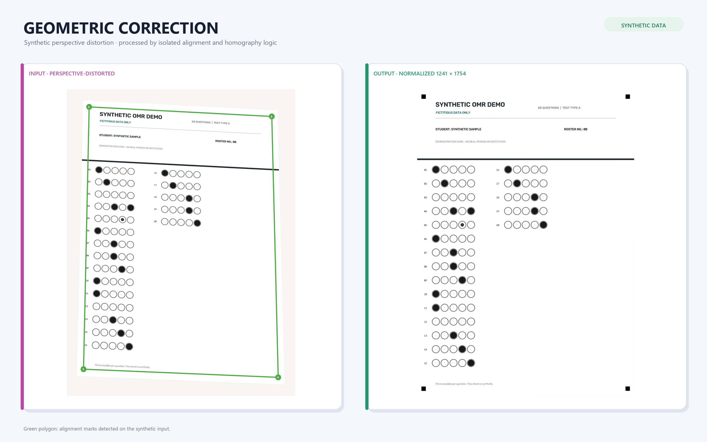
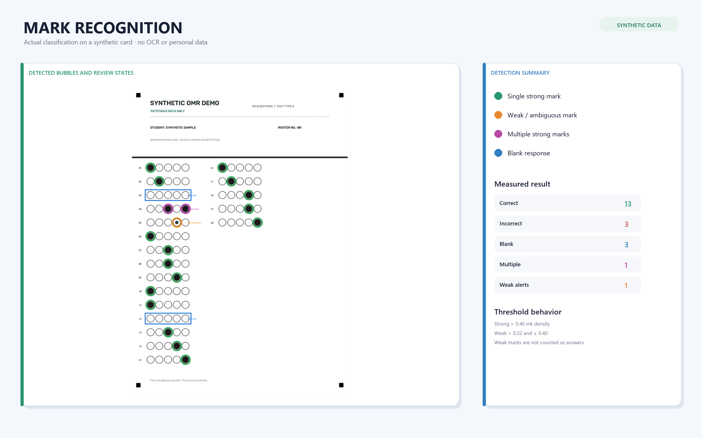
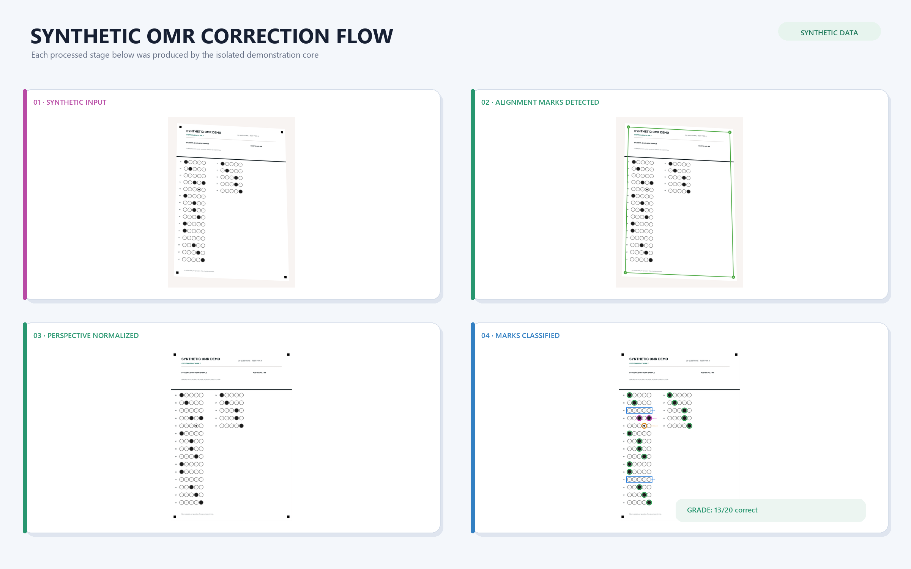

# Offline Optical Mark Recognition for Assessment Grading

Technical portfolio documentation for a desktop system that processes scanned answer sheets, recognizes marked choices, grades assessments in batches, and produces local indicators and reports.

The planned public version is intentionally selective. It documents the architecture and the most relevant algorithms from the original project without releasing the full application, school records, real configuration files, licensing mechanisms, or private integrations.

## Problem

Manual grading of multiple-choice assessments is time-consuming and makes class-level and question-level analysis difficult. The original project was built to automate this workflow on Windows computers, including environments with limited connectivity.

The system processes a scanned PDF and combines three sources of information:

- answer-bubble geometry and ink coverage;
- the name and roster number written on the sheet;
- an optional local student roster.

It then produces grades, review data, descriptive statistics, Excel workbooks, and PDF reports.

## Private original system — documented scope

The existing desktop workflow implements:

- answer-sheet generation for 10 to 100 questions;
- up to four test variants;
- one or two answer sheets per scanned page;
- rotation and perspective correction using alignment marks;
- grid calibration based on detected bubbles rather than fully fixed coordinates;
- classification of strong, weak, missing, and multiple marks;
- page-level and sheet-level fault isolation during batch processing;
- optional CSV and Excel roster association;
- subject-aware grading and answer-key selection by test variant;
- class, subject, and question-level descriptive indicators;
- local Excel, PDF, and SQLite outputs.

These capabilities describe the original system that was reviewed. This repository does not contain or execute the complete desktop application, OCR, student association, batch PDF processing, indicators, reports, or persistence.

No accuracy metric is claimed. This portfolio will not report recognition rates, production volumes, or paper-based validation results without reproducible evidence.

## Original-system architecture

The primary pipeline runs locally:

1. PyMuPDF renders PDF pages into images.
2. Landscape pages may be split into two answer sheets.
3. OpenCV and NumPy perform grayscale conversion, thresholding, morphology, and contour analysis.
4. Corner alignment marks are used to estimate a perspective transform.
5. The answer grid is reconstructed from detected circular bubbles.
6. Ink coverage inside each region determines the selected choices.
7. The grading engine compares responses with the appropriate answer key.
8. Pandas and NumPy calculate tables and descriptive statistics.
9. OpenPyXL, PyMuPDF, and SQLite produce local artifacts.

The optional online integration found in the original application retrieves answer-key configuration. It is outside the planned public scope.

See [docs/architecture.md](docs/architecture.md) for the complete flow.

## Features executable in this repository

The public demonstration contains only:

- generation of a fictional 20-question answer sheet;
- tilted and perspective-distorted variants;
- four-mark detection and projective transformation;
- A–E grid calibration using contours and medians;
- classification of strong, weak, blank, and multiple marks;
- simplified grading into correct, incorrect, blank, or multiple;
- generation of the images, GIF, and JSON shown below.

Batch processing, OCR, student association, A–D test variants, educational statistics, Excel, PDF, SQLite, and the desktop UI are documented parts of the original system and are not implemented in the public demonstration.

The isolated core's provenance and differences are recorded in [docs/technical-overview.md](docs/technical-overview.md). Technical preparation of this portfolio does not automatically resolve ownership or authorization to publish.

## Technologies

### Executable demonstration

- Python 3.14;
- OpenCV;
- NumPy;
- Pillow;
- pytest.

### Documented original system, not distributed

- PyMuPDF, Pandas, and OpenPyXL;
- Tesseract OCR / Pytesseract;
- SQLite;
- Tkinter and CustomTkinter;
- PyInstaller and Inno Setup.

## Technical challenges addressed

### Variable scan geometry

Scans may contain rotation, scaling, perspective distortion, or manually cropped sheets. The implementation searches for isolated alignment blocks near the corners, validates their geometry, and applies a projective transform before reading the grid.

### Partial grid detection

Bubble candidates are grouped by row, the three-column or four-column layout is inferred, and median positions are used to reconstruct missing coordinates. This reduces dependence on absolute pixel locations.

### Ambiguous marks

Two thresholds distinguish counted marks from weak fills. Multiple choices for a question are preserved as an invalid response, and ambiguous cases can be sent for human review.

### Localized failures in the original system

An unreadable page produces its own error result instead of necessarily terminating the entire batch. Progress and results are passed to the user interface through a queue while image processing runs in a worker thread.

This batch-processing path is not part of the executable code in this repository.

## Demonstrable technical outcomes

Using synthetic data only, the code included in this repository demonstrates:

- normalization of a perspective-distorted answer sheet;
- reconstruction of answer-grid positions;
- visual overlays for strong, weak, blank, and multiple marks;
- simplified grading of correct, incorrect, blank, and multiple answers;
- deterministic reproduction of the synthetic JSON result.

These are observable software capabilities, not a certified accuracy claim or evidence of suitability for automated educational decisions.

## Installation and reproduction

Validated prerequisite: Python 3.14.

```powershell
python -m venv .venv
.\.venv\Scripts\Activate.ps1
python -m pip install -r requirements.txt
```

On Linux or macOS, activate the environment with `source .venv/bin/activate`.

Regenerate the answer sheets and results:

```powershell
python -B examples/visual_demo/generate_synthetic_cards.py
python -B examples/visual_demo/render_real_demo.py
python -B examples/create_conceptual_flow.py
```

Run the tests:

```powershell
python -m pytest -q
```

Dependencies are pinned in [requirements.txt](requirements.txt). The demonstration scripts do not import or access the private project.

## Known limitations

- The original project has no identified automated test suite; the public demonstration has its own synthetic tests.
- No public OMR or OCR benchmark is available.
- Name matching uses textual similarity and requires supervision for ambiguous cases.
- Several geometric thresholds were calibrated for the project's answer-sheet format.
- The original main file combines UI, domain logic, persistence, and reporting.
- Interpretive educational indicators are heuristics, not validated diagnoses.
- The complete application includes confidential elements and will not be released.

Additional details are available in [docs/limitations.md](docs/limitations.md).

## Public-version scope

The content prepared for possible publication contains only selected algorithms, documentation, and synthetic examples. It excludes:

- the complete desktop application;
- databases and student rosters;
- real answer sheets, reports, or spreadsheets;
- institutional visual identity;
- credentials, configured URLs, and license keys;
- the online portal and administrative routines;
- educational materials without explicit permission;
- executables, installers, virtual environments, and build artifacts.

## Visual demonstration

Every card below was generated from scratch with fictional data. No screenshot, answer sheet, or identifier from the real environment was used.

### Geometric correction — actual processing

The comparison shows four detected alignment marks and the projective transform executed by the isolated OMR core.



### Mark recognition — actual processing

The overlay distinguishes strong, weak, multiple, and blank responses. On the controlled fixture, the algorithm measured 13 correct, 3 incorrect, 3 blank, and 1 multiple response. This result demonstrates reproducible execution of one synthetic scenario; it is not an accuracy metric.



### Complete flow — actual processing



An animated version is available at [media/omr-demo.gif](media/omr-demo.gif). In contrast, [media/omr-processing-flow.png](media/omr-processing-flow.png) is a conceptual illustration rather than engine output.

## Author and rights

- **Author:** [Maurylia Loureiro](https://github.com/LariMaury)
- **GitHub:** [@LariMaury](https://github.com/LariMaury)
- **Contact:** [mauryliapro@gmail.com](mailto:mauryliapro@gmail.com)

This material is presented as all rights reserved and without an open-source license grant. This notice does not replace confirmation of authorship, ownership, and authorization to publish by the responsible party before the repository is made public.
