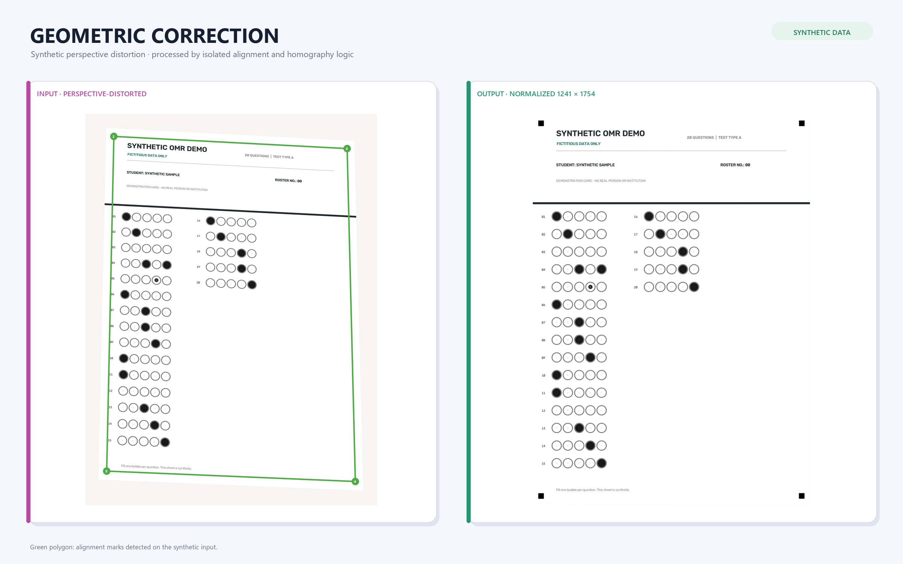
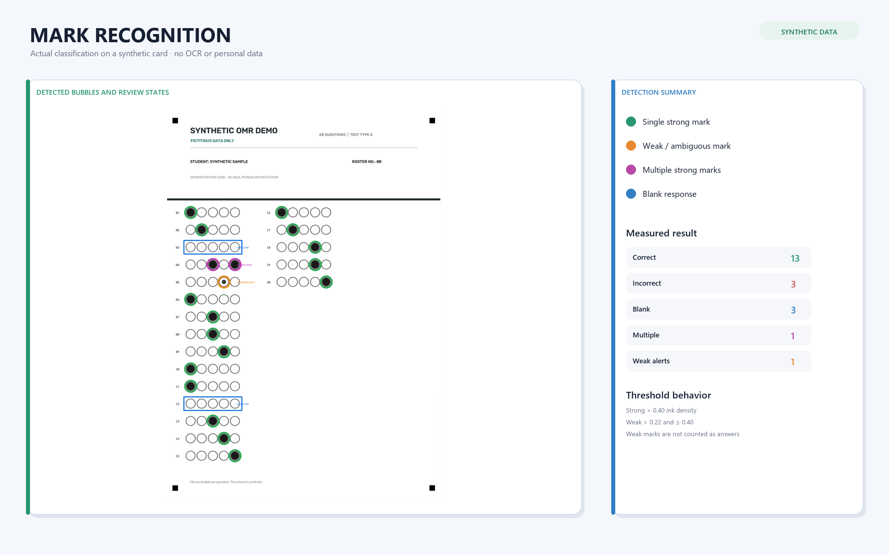
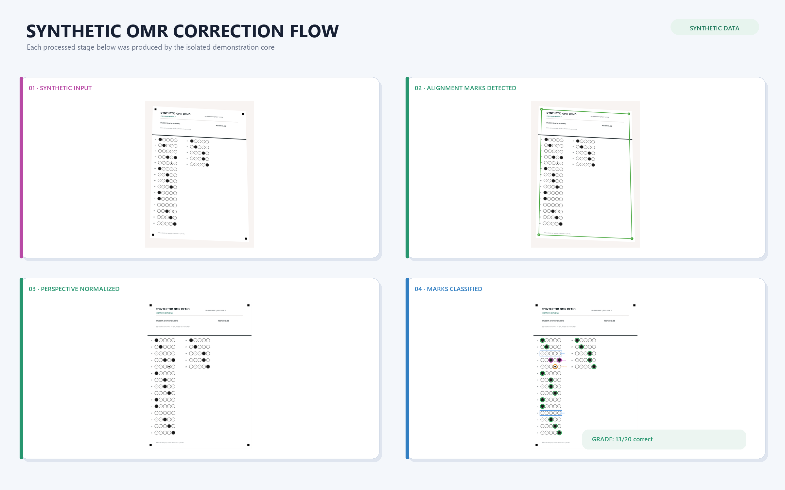

# Correção Offline de Avaliações por Leitura Ótica

Portfólio técnico de um sistema desktop para processar cartões-resposta digitalizados, reconhecer marcações, corrigir avaliações em lote e produzir indicadores e relatórios localmente.

Esta versão pública planejada é deliberadamente seletiva. Ela documenta a arquitetura e os algoritmos mais relevantes do projeto original, sem publicar a aplicação completa, dados escolares, configurações reais, mecanismos de licenciamento ou integrações privadas.

## Problema

A correção manual de avaliações objetivas consome tempo, dificulta a consolidação de resultados por turma e torna análises questão a questão pouco práticas. O projeto original foi criado para automatizar esse fluxo em computadores Windows, inclusive em ambientes com conectividade limitada.

O sistema recebe um PDF digitalizado contendo cartões-resposta e combina três fontes de informação:

- geometria e preenchimento das bolhas;
- nome e número de chamada presentes no cartão;
- lista local de estudantes, quando fornecida.

Ao final, produz notas, dados de conferência, estatísticas descritivas e documentos em Excel e PDF.

## Sistema original privado — escopo documentado

O fluxo desktop existente implementa:

- geração de cartões-resposta com 10 a 100 questões;
- suporte a até quatro tipos de prova;
- leitura de uma ou duas fichas por página digitalizada;
- correção de rotação e perspectiva por marcas de alinhamento;
- calibração da grade a partir das bolhas detectadas, em vez de coordenadas inteiramente fixas;
- classificação de marcações fortes, fracas, ausentes e múltiplas;
- processamento tolerante a falhas por página e por cartão;
- associação opcional com listas CSV e Excel;
- correção multidisciplinar e seleção do gabarito pelo tipo de prova;
- cálculo de indicadores por turma, disciplina e questão;
- geração local de planilhas, PDFs e histórico SQLite.

Essas capacidades descrevem o sistema original analisado. Este repositório não contém nem executa a aplicação desktop completa, OCR, associação de estudantes, processamento de PDFs em lote, indicadores, relatórios ou persistência.

Não há métrica publicada de precisão. O repositório de portfólio não apresentará taxa de acerto, volume de produção ou validação em papel sem evidência reproduzível.

## Arquitetura do sistema original

O processamento principal é local:

1. O PDF é renderizado em imagens com PyMuPDF.
2. Páginas em paisagem podem ser divididas em dois cartões.
3. OpenCV e NumPy executam conversão para tons de cinza, limiarização, morfologia e análise de contornos.
4. Marcas nos cantos permitem estimar uma transformação de perspectiva.
5. A grade é reconstruída a partir das bolhas circulares detectadas.
6. A quantidade de tinta em cada região determina as alternativas marcadas.
7. O motor de correção compara as respostas com o gabarito correspondente.
8. Pandas e NumPy calculam tabelas e estatísticas descritivas.
9. OpenPyXL, PyMuPDF e SQLite produzem as saídas locais.

A integração online encontrada no sistema original é opcional e serve apenas para obtenção de configurações de gabarito. Ela não faz parte do escopo público planejado.

Veja o fluxo completo em [docs/architecture.md](docs/architecture.md).

## Funcionalidades executáveis neste repositório

O demonstrador público contém somente:

- geração de um cartão fictício de 20 questões;
- criação de variantes inclinada e deformada por perspectiva;
- detecção de quatro marcas de alinhamento e transformação projetiva;
- calibração de uma grade A–E por contornos e medianas;
- classificação de marcações fortes, fracas, ausentes e múltiplas;
- avaliação simplificada em correta, incorreta, branca ou múltipla;
- geração das imagens, do GIF e do JSON apresentados abaixo.

Processamento em lote, OCR, associação de estudantes, tipos A–D, estatísticas educacionais, Excel, PDF, SQLite e interface desktop são apenas documentados como partes do sistema original e não estão implementados no demonstrador público.

A origem e as diferenças do núcleo isolado estão registradas em [docs/technical-overview.md](docs/technical-overview.md). A preparação técnica deste portfólio não resolve automaticamente titularidade ou autorização de publicação.

## Tecnologias

### Demonstrador executável

- Python 3.14;
- OpenCV;
- NumPy;
- Pillow;
- pytest.

### Sistema original documentado, não distribuído

- PyMuPDF, Pandas e OpenPyXL;
- Tesseract OCR / Pytesseract;
- SQLite;
- Tkinter e CustomTkinter;
- PyInstaller e Inno Setup.

## Desafios técnicos tratados

### Geometria variável

Digitalizações podem apresentar rotação, escala, perspectiva ou cartões recortados. O sistema procura blocos de alinhamento próximos aos cantos, valida sua geometria e aplica uma transformação projetiva antes da leitura.

### Grade parcialmente detectada

O algoritmo agrupa candidatos por linha, infere o layout de três ou quatro colunas e usa medianas para reconstruir posições ausentes. Isso reduz a dependência de coordenadas absolutas.

### Marcações ambíguas

Dois limiares distinguem marcações contabilizadas de preenchimentos fracos. Múltiplas alternativas na mesma questão são mantidas como resposta inválida, e os casos ambíguos podem ser encaminhados para revisão.

### Falhas localizadas no sistema original

Uma página ilegível gera um resultado de erro próprio sem interromper necessariamente o lote inteiro. A interface recebe progresso e resultados por uma fila, enquanto a leitura é executada em uma thread de trabalho.

Esse processamento em lote não faz parte do código executável deste repositório.

## Resultados técnicos demonstráveis

O código incluído neste repositório demonstra, com dados exclusivamente sintéticos:

- normalização de um cartão deformado;
- reconstrução das posições da grade;
- mapa visual de bolhas fortes, fracas, vazias e múltiplas;
- avaliação simplificada de acerto, erro, branco e resposta múltipla;
- reprodução determinística do resultado sintético em JSON.

Esses resultados descrevem capacidades observáveis do código. Não equivalem a uma certificação de precisão ou adequação para decisões pedagógicas.

## Instalação e reprodução

Pré-requisito validado: Python 3.14.

```powershell
python -m venv .venv
.\.venv\Scripts\Activate.ps1
python -m pip install -r requirements.txt
```

No Linux ou macOS, ative o ambiente com `source .venv/bin/activate`.

Gere novamente os cartões e os resultados:

```powershell
python -B examples/visual_demo/generate_synthetic_cards.py
python -B examples/visual_demo/render_real_demo.py
python -B examples/create_conceptual_flow.py
```

Execute os testes:

```powershell
python -m pytest -q
```

As dependências estão fixadas em [requirements.txt](requirements.txt). Os scripts do demonstrador não importam nem acessam o projeto privado.

## Limitações conhecidas

- O projeto original não possui suíte de testes automatizados identificada; o demonstrador público possui testes sintéticos próprios.
- Não existe benchmark de OMR ou OCR publicado.
- A identificação por nome usa aproximação textual e requer supervisão em casos ambíguos.
- Vários limites geométricos foram ajustados ao modelo de cartão do projeto.
- O arquivo principal original concentra interface, domínio, persistência e relatórios.
- Indicadores educacionais mais interpretativos são heurísticas, não diagnósticos validados.
- A aplicação completa contém elementos confidenciais e não será publicada.

Detalhes adicionais estão em [docs/limitations.md](docs/limitations.md).

## Escopo da versão pública

O conteúdo preparado para eventual publicação contém somente algoritmos selecionados, documentação e exemplos sintéticos. Permanecem fora do repositório:

- aplicação desktop completa;
- banco de dados e listas de estudantes;
- cartões, relatórios ou planilhas reais;
- identidade visual institucional;
- credenciais, URLs configuradas e chaves de licença;
- portal online e rotinas administrativas;
- materiais pedagógicos sem autorização;
- executáveis, instaladores, ambientes virtuais e artefatos de build.

## Demonstração visual

Todos os cartões abaixo foram gerados do zero com dados fictícios. Nenhuma captura, ficha ou identificação do ambiente real foi utilizada.

### Correção geométrica — processamento real

O comparativo mostra a detecção das quatro marcas de alinhamento e a transformação projetiva executada pelo núcleo OMR isolado.



### Reconhecimento das marcações — processamento real

A sobreposição diferencia marcações fortes, fracas, múltiplas e em branco. Na fixture controlada, o algoritmo mediu 13 respostas corretas, 3 incorretas, 3 em branco e 1 múltipla. Esse resultado valida apenas a execução reproduzível do cenário sintético; não é uma métrica de precisão.



### Fluxo completo — processamento real



Uma versão animada está disponível em [media/omr-demo.gif](media/omr-demo.gif). O diagrama [media/omr-processing-flow.png](media/omr-processing-flow.png), por sua vez, é uma ilustração conceitual e não uma saída do motor.

## Autoria e direitos

- **Autora:** [Maurylia Loureiro](https://github.com/LariMaury)
- **GitHub:** [@LariMaury](https://github.com/LariMaury)
- **Contato:** [mauryliapro@gmail.com](mailto:mauryliapro@gmail.com)

Este material é apresentado com direitos reservados e sem concessão de licença de código aberto. Este aviso não substitui a confirmação de autoria, titularidade e autorização de publicação pelo responsável antes de tornar o repositório público.
