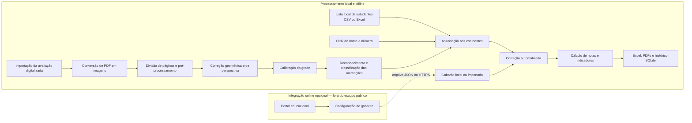

# Arquitetura do processamento

## Visão geral

O projeto original segue uma arquitetura desktop procedural. A interface coordena importação, leitura, correção, persistência e relatórios. Embora essas responsabilidades estejam concentradas no mesmo módulo, o fluxo de dados pode ser documentado em estágios claramente identificáveis.

O diagrama separa o pipeline local da integração online opcional. O demonstrador deste repositório cobre somente correção geométrica, calibração, classificação e avaliação simplificada sobre entradas sintéticas.

## Confirmação dos estágios no código original

| Estágio | Implementação observada | Responsabilidade |
|---|---|---|
| Importação de listas | `obter_mapa_turmas`, `carregar_lista_completa` | Lê CSV, XLS e XLSX, inclusive múltiplas abas. |
| PDF para imagem | `ler_lote` | Abre o PDF e renderiza cada página a 150 DPI com PyMuPDF. |
| Divisão de página | `dividir_folhas` | Divide páginas em paisagem em duas metades. |
| Correção geométrica | `corrigir_perspectiva_por_marcas` | Detecta quatro marcas e aplica transformação projetiva. |
| Rotação | `corrigir_folha` | Tenta a orientação original e uma rotação de 180 graus. |
| Calibração | `calibrar_grade` | Reconstrói linhas e posições das alternativas a partir dos contornos. |
| OCR | `extrair_nome`, `extrair_numero_chamada` | Usa texto nativo quando disponível e Tesseract como alternativa. |
| Classificação de bolhas | `_corrigir_folha_interna` | Mede a proporção de tinta em uma máscara circular. |
| Tipo de prova | `detectar_tipo`, `gabarito_do_resultado` | Identifica A–D e seleciona a chave correspondente. |
| Correção | `avaliar_respostas` | Classifica respostas corretas, incorretas, brancas ou múltiplas. |
| Indicadores | `montar_estatisticas` | Calcula resumo, desempenho por disciplina, faixas e análise por questão. |
| Relatórios | `salvar_resultados`, `gerar_boletins`, `gerar_relatorio_turma` | Produz Excel e PDFs. |
| Histórico | `bd_registrar_correcao` | Persiste correções, notas e respostas em SQLite. |
| Integração opcional | `buscar_gabaritos_do_portal` | Obtém gabaritos por HTTPS quando configurado. |

## Fronteira do demonstrador público

O código executável começa em uma imagem sintética e termina em estruturas de respostas, contagens de avaliação e artefatos visuais. A importação de PDF e os indicadores mostrados no diagrama pertencem apenas ao sistema original documentado. O demonstrador não inclui:

- autenticação ou acesso ao portal;
- armazenamento de nomes reais;
- banco de dados do sistema original;
- interface completa;
- geração de licenças;
- caminhos e configurações de uma instalação real.

## Dependências por etapa

| Etapa | Dependências principais |
|---|---|
| Renderização de PDF | PyMuPDF |
| Processamento de imagem | OpenCV e NumPy |
| OCR opcional | Tesseract e Pytesseract |
| Dados tabulares | Pandas e OpenPyXL |
| Relatórios PDF | PyMuPDF |
| Persistência local | SQLite da biblioteca padrão |
| Interface original | Tkinter, CustomTkinter e Pillow |
